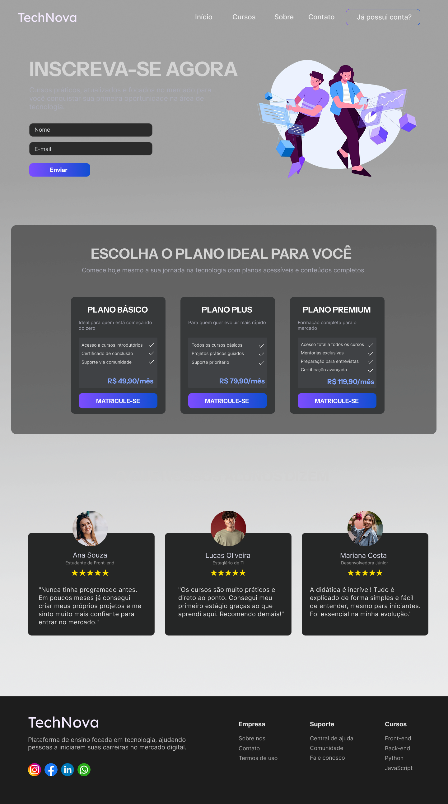
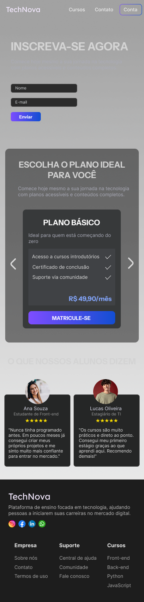

# 🚀 TechNova - Plataforma de Cursos 

Desenvolvimento de uma plataforma de cursos fictícia de cursos de tecnologia, com foco em conversão, experiência do usuário e design responsivo.

## 🎯 Objetivo

Criar uma interface moderna e funcional simulando um produto real do mercado, aplicando conceitos de UI/UX e desenvolvimento front-end.

## 🖥️ Telas Desenvolvidas

* Desktop
* Desktop Wide
* Tablet
* Mobile

## 🎨 Design

O layout foi prototipado no Figma com foco em:

* Hierarquia visual clara
* Experiência do usuário (UX)
* Interface moderna (Dark Mode)
* Responsividade entre dispositivos

## 📸 Preview do Projeto

### 💻 Desktop

### 📱 Mobile

## 🛠️ Tecnologias (em desenvolvimento)

* HTML5 (semântico)
* CSS3 (Flexbox e Grid)
* Responsividade (Mobile-first)
* JavaScript (futuro)

## 🚧 Status do Projeto

🟡 Em desenvolvimento

Atualmente na fase de prototipação e estruturação.
Próximo passo: implementação do código.

## 📌 Próximos passos

* [ ] Estruturar HTML semântico
* [ ] Desenvolver o CSS responsivo
* [ ] Adicionar interações
* [ ] Realizar deploy

